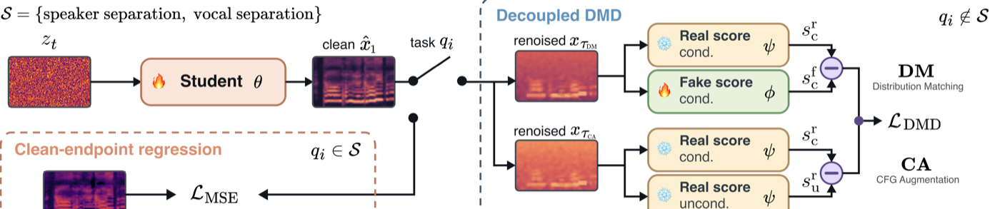
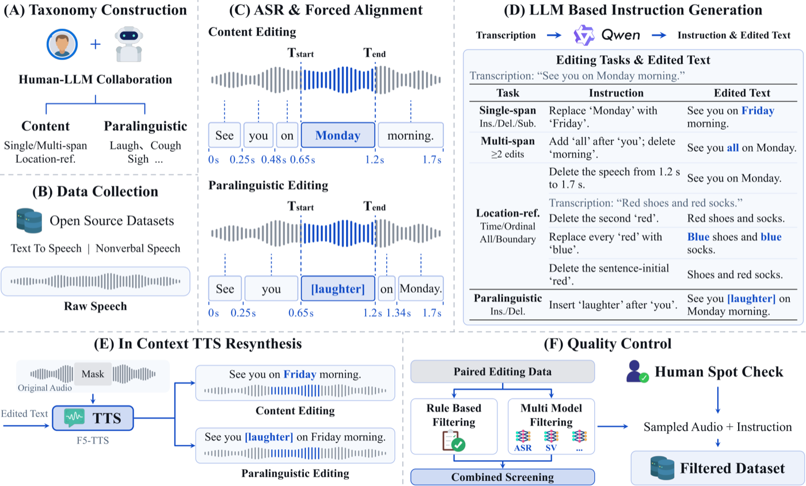
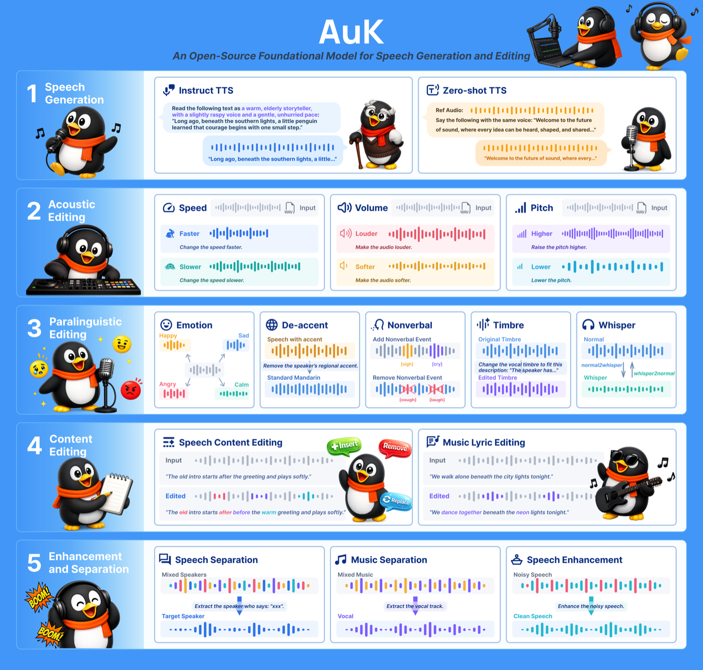
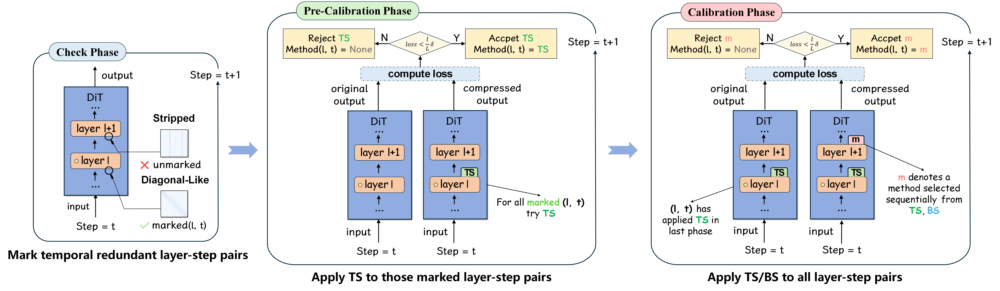
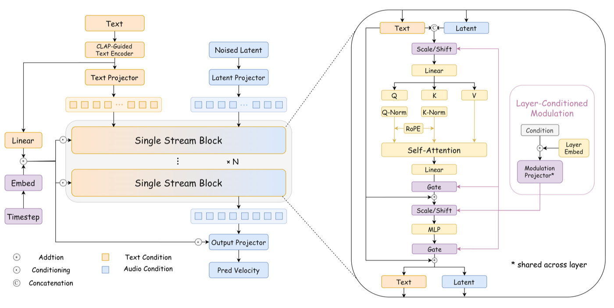
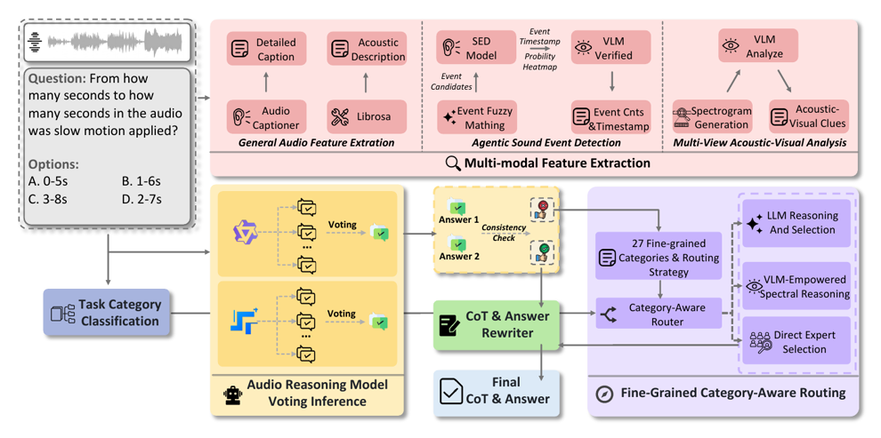
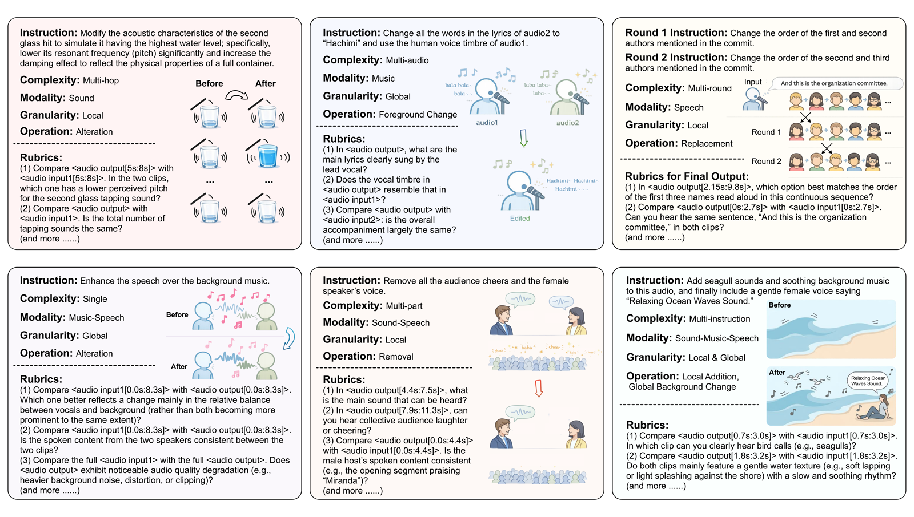

I'm currently a first-year Ph.D. student (2026) at [X-LANCE Lab](https://x-lance.sjtu.edu.cn/en), [Shanghai Jiao Tong University](https://en.sjtu.edu.cn/) & [Beijing Institute for General Artificial Intelligence (BIGAI)](https://www.bigai.ai/), advised by [Prof. Xie Chen](https://chenxie95.github.io/) and [Dr. Zilong Zheng](https://zilongzheng.github.io/).

**Research Interests:** Speech synthesis, Audio understanding.

## 📖 Education
- **2026.09 - 2031.06 (expected)**, Ph.D., X-LANCE Lab, Shanghai Jiao Tong University (SJTU) & Beijing Institute for General Artificial Intelligence (BIGAI)
- **2022.09 - 2026.06**, B.E., Xiamen University (XMU)

## 💼 Internship
- **2026.07 - present**, Tencent Hunyuan, Shanghai, China
- **2025.11 - 2026.06**, Sii & OpenMOSS, Shanghai, China

## 🔥 News
- **2026.06**: Our VISA paper was accepted to **INTERSPEECH 2026** and selected for an oral presentation!
- **2026.04**: 1 paper was accepted by **ACL 2026 Findings**!
- **2026.02**: We won 2nd place in the Agent Track of the [Interspeech 2026 Audio Reasoning Challenge](https://audio-reasoning-challenge.github.io/leaderboard/). See the [Challenge Report](https://arxiv.org/abs/2602.14224).

## 📝 Publications

[Route-DMD: Distribution Matching Distillation with Task-Routed Mechanism for Speech Foundation Models](https://arxiv.org/abs/2611.08011)

**Yanru Huo**, Zhikang Niu, Wenming Tu, Junxi Liu, Tian Tan, Shan Yang, Yipeng Kang, Ziyang Ma, Xie Chen, Zilong Zheng
\\

[VoxCanvas-41M: A Large-Scale Bilingual Dataset for Instruction-Based Speech Editing and Its Learning Dynamics](https://arxiv.org/abs/2611.08251)

Zhikang Niu, Wenming Tu, Yalin Li, **Yanru Huo**, Junxi Liu, Tianrui Wang, Ruiqi Yan, Junxuan Liang, Ziyang Ma, Zilong Zheng, Xie Chen
\\

[AuK Technical Report: An Open-Source Foundational Model for Speech Generation and Editing](https://arxiv.org/abs/2609.08936)

AuK Team
\\
*Core Contributor.*
\\

[DiTReducio: A Training-Free Acceleration for DiT-Based TTS via Progressive Calibration](https://arxiv.org/abs/2509.09748)

**Yanru Huo**, Ziyue Jiang, Zuoli Tang, Qingyang Hong, Zhou Zhao\*
\\
ACL 2026 Findings
\\

[TinyAudio: Compact and Efficient Text-to-Audio Generation for Low-Resource Deployment](https://arxiv.org/abs/2609.31525)

Junxi Liu, Xiquan Li, Wenhao Guan, Yifan Duan, Zhikang Niu, **Yanru Huo**, Ziyang Ma, Xie Chen
\\

[VISA: A Visual Information Strengthened Audio-Reasoning System for the Interspeech 2026 ARC Agent Track](https://arxiv.org/abs/2606.07264)

Wenming Tu, Jian Gao, **Yanru Huo**, Yixuan Wang, Jing Peng, Bohan Li, Ziyang Ma, Tao Liu, Shuai Fan, Kai Yu, Xie Chen, Zilong Zheng
\\
INTERSPEECH 2026 (Oral)
\\

[MMAE: A Massive Multitask Audio Editing Benchmark](https://arxiv.org/abs/2606.07229)

MMAE Team
\\
Contributor.
\\

[MOVA: Towards Scalable and Synchronized Video-Audio Generation](https://arxiv.org/abs/2602.08794)

SII-OpenMOSS Team
\\
*Core contributor.*
\\

## 🎖 Honors and Awards
- **2024.11**, Second Prize, China Undergraduate Mathematical Contest in Modeling (CUMCM), National Level
- **2024.09**, National Scholarship
